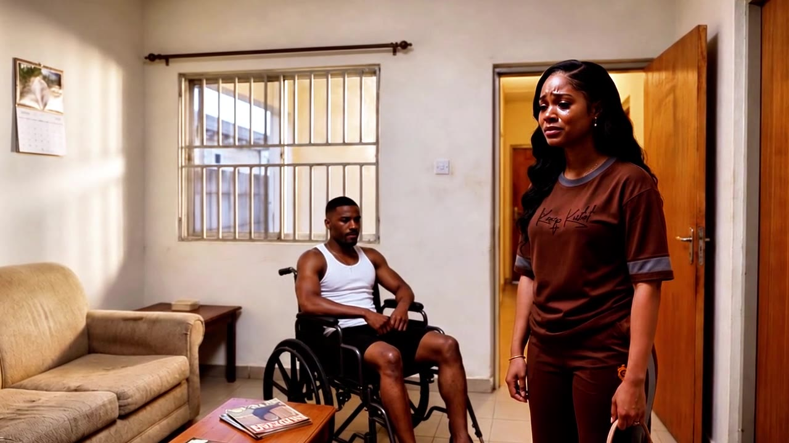

# ReelForge Studio

ReelForge Studio is an AI film studio. One idea becomes a screenplay, a cast and location bible, a storyboard with chained start and end frames, a continuity check, a voice track, and an MP4.

It is built for the Meta Global AI Developer Hackathon 2026. Accounts, email verification, and an admin console are part of the app. The live site is [reelforge.voiceforgeai.site](https://reelforge.voiceforgeai.site).



## What it does

- **Projects.** Drama, documentary, product ad, and anime. Realistic, 3D, cartoon, or anime look. YouTube Shorts, TikTok, Facebook Reels, and long YouTube. The platform format sets the aspect ratio and the maximum length.
- **Writers’ room.** Brainstorm cards, then a screenplay in standard format.
- **Cast, props, locations.** Reference sheets, then a shot list with start and end frames.
- **Continuity.** A vision pass compares frames with the production bible and can redo a frame that drifted.
- **Voice.** Self-hosted Meta MMS-TTS. Each line is checked with Meta wav2vec2 (`facebook/wav2vec2-base-960h`).
- **Cut.** Ken Burns, parallax, and crossfades over the stills (FFmpeg, and HyperFrames when that sidecar is up), music, subtitles, loudness, MP4.
- **Reel.** An agent that can run those steps, with a real Linux desktop you can watch or take over.
- **Accounts.** Sign up, verify email, reset a password, profile, and per-user projects. Admin configures keys, storage, and usage limits.

## Meta models only

`META_ONLY` defaults to **on**. While it is on, every model called at runtime is a Meta model:

| Step | Model |
|---|---|
| Writing, directing, agent, computer use, continuity review | Muse Spark 1.3, with Muse Wonder 1.0 for hard tasks |
| Open-weight text fallback | Baseten `meta-models/muse-spark-open-1026` only |
| Images | Muse Image 1.0 |
| Person segmentation (optional) | SAM 3.1 |
| Voice | Meta MMS-TTS, `facebook/mms-tts-*`, self-hosted in `services/mms-tts` |
| Dialogue clarity and voice input | Meta wav2vec2, `facebook/wav2vec2-base-960h`, same service |

Character “voices” are pitch and tempo shapes on that one MMS voice. They are not Microsoft Edge, ElevenLabs, or other neural voices.

Offline espeak-ng and local FFmpeg are system tools, not AI models. They run only as a last resort or for the picture cut.

Adapters for Edge, ElevenLabs, xAI, OpenAI-compatible chat, Veo, LTX, MiniMax, and similar video APIs stay in the repo. While `META_ONLY` is on they are not called, not offered as the active provider, and not listed as live in `/api/status`. Turning the switch off is an admin action and is not the hackathon configuration. `VIDEO_MOTION_BETA` (LTX on Runpod) stays off while Meta-only is on.

MMS-TTS weights are CC-BY-NC 4.0 (non-commercial). wav2vec2-base-960h is Apache-2.0.

## Setup

```bash
cp .env.example .env
npm install
npx playwright install chromium   # or set CHROMIUM_PATH
npm run dev                       # http://localhost:3000
```

`ffmpeg` must be on `PATH`. The first admin signs in at `/admin` with `ADMIN_EMAIL` and `ADMIN_PASSWORD`. Creators sign up at `/signup`.

Docker, including the voice service:

```bash
docker compose up --build
```

The VPS compose file is `deploy/docker-compose.vps.yml` (desk, app, HyperFrames, and `tts`). This repository does not deploy that file.

### Environment

| Variable | Purpose |
|---|---|
| `APP_SECRET` | Encrypts admin secrets and signs session cookies. Required in production. |
| `ADMIN_EMAIL`, `ADMIN_PASSWORD` | Admin login. Use `ADMIN_PASSWORD_HASH` instead of a plain password if you prefer. |
| `META_API_KEY`, `META_BASE_URL` | Meta Model API. Can also be set in `/admin`. |
| `META_ONLY` | `on` (default). Non-Meta chat, voice, and video providers do not run. |
| `MMS_TTS_URL` | Self-hosted voice service. Default `http://tts:8000` in Compose. |
| `BASETEN_API_KEY` | Optional. Only Meta open weights (`muse-spark-open`) are used while Meta-only is on. |
| `DATA_DIR` | JSON database, jobs, and the media cache. Default `./data`. |
| `R2_ENABLED`, `R2_ACCOUNT_ID`, `R2_ACCESS_KEY_ID`, `R2_SECRET_ACCESS_KEY`, `R2_BUCKET`, `R2_ENDPOINT` | Cloudflare R2. The app streams objects through `/api/files` and caches them on disk. `R2_PUBLIC_URL` is optional. |
| `QUOTA_HOURLY`, `QUOTA_DAILY` | Per-user Meta API caps (defaults 40/hour and 160/day). `0` disables that window. The admin account is not capped. Also editable in Admin. |
| `SIGNUPS` | `open` or `closed`. |
| `RESEND_API_KEY` or `SMTP_URL`, `EMAIL_FROM`, `APP_URL` | Account email. If email is not configured, sign-ups are marked verified. |
| `YOUTUBE_API_KEY` | Optional Data API for research. Not a generative model. |
| `CHROMIUM_PATH`, `DESK_URL`, `DESK_CDP_URL` | Reel’s computer. |

Keys saved in `/admin` are AES-GCM encrypted with `APP_SECRET`. `.env` and `data/` are gitignored. Do not commit real keys.

## Layout

```
src/app          pages and route handlers
src/lib          pipeline, Meta router, storage, auth, quota
src/components   studio, landing, admin
services/mms-tts self-hosted Meta MMS-TTS and wav2vec2
services/hyperframes   shot animator (FFmpeg fallback if it is down)
desk             Linux desktop the agent can drive
deploy/docker-compose.vps.yml
```

Media URLs are `/api/files/...`. When R2 is on and the file is not on disk, the server downloads it with a signed request, caches it, and serves it with `Cache-Control` and an ETag. The browser is not sent to an expiring R2 URL.

## Development

```bash
npm run lint
npm test
npm run build
```

`npm test` runs the small Node test files under `src/lib`. There is no hosted CI in this repo.
